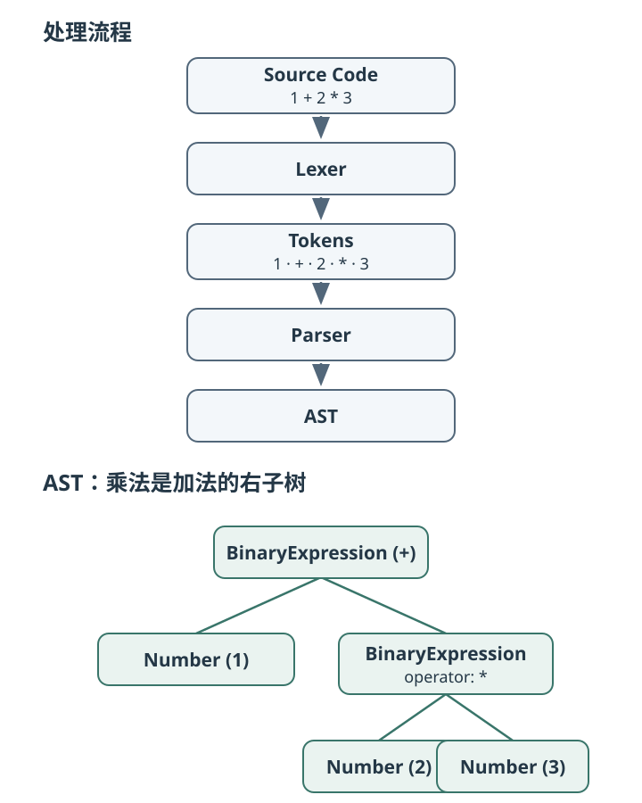

# 从源代码到抽象语法树（From Source Code to AST）

当我们写下 `1 + 2 * 3`，计算机并不会直接“看懂”这串字符。语言实现通常会逐步把字符识别为词元（Token），再按语法规则组织为抽象语法树（Abstract Syntax Tree，AST）。这棵树表达了程序的结构；后续的解释器或编译器再根据语言语义处理它。

## 从字符到结构

### Source Code：程序的文本表示

源代码（Source Code）是人按照某种编程语言的字符和语法规则编写的文本。这里的 `1 + 2 * 3` 是一个表达式：它包含数字字符、空格和运算符。空格可能只是分隔字符，不一定成为语法结构的一部分；具体如何处理由语言规则决定。

可以把它想成一条句子：字符是字母和标点，词法分析先识别“词”，语法分析再判断这些词如何组成句子。这个类比只帮助理解两阶段的分工；程序语言的词法和语法规则由语言本身精确定义。

### Lexer：把字符识别为 Token

词法分析器（Lexer，也称 Scanner）从左到右读取字符，把字符片段归类为 Token。Token 通常包含种类和必要的词素信息，例如数字的数值或标识符的名称。

对 `1 + 2 * 3`，一个简化的 Lexer 会得到：

```text
NUMBER(1), PLUS, NUMBER(2), STAR, NUMBER(3), EOF
```

`NUMBER(1)` 表示一个数字词元及其值；`PLUS`、`STAR` 表示运算符；`EOF` 是输入结束标记。Lexer 识别这些单元，但不会决定 `*` 要先于 `+` 计算。

### Parser：按语法规则组织 Token

语法分析器（Parser）接收 Token 序列，并检查它们能否组成语言允许的结构。它依据文法（Grammar）建立节点及父子关系。针对本例，可以用一组分层规则表达优先级：

```text
expression  → addition
addition    → multiplication ("+" multiplication)*
multiplication → primary ("*" primary)*
primary     → NUMBER | "(" expression ")"
```

这里 `addition` 的操作数是 `multiplication`，而乘法层再读取基本项 `primary`。因此解析 `1 + 2 * 3` 时，右侧 `2 * 3` 会先作为一个完整子表达式建立，再和左侧的 `1` 一起组成加法。括号也在 `primary` 规则里递归解析；例如 ` (1 + 2) * 3 ` 会先把括号内的加法作为乘法的左操作数。

不同语言可以有不同的文法和优先级规则。以上规则只覆盖整数、加号、乘号和括号，是为本例编写的教学用文法，不是任何完整语言的规范。

### AST：保留有意义的程序结构

抽象语法树（AST）是按语法结构组织的树形表示。“抽象”表示它关注后续处理需要的语法关系，通常不保留每个空格、括号等原始排版细节。具体 AST 节点如何定义，由语言实现决定。

```text
        Add
       /   \
      1    Multiply
           /      \
          2        3
```

本例的根节点是加法，右子树是乘法。这正好表示 `1 + (2 * 3)`。如果树把乘法放在加法根节点的上方，就表示 `(1 + 2) * 3`，与通常的乘法优先规则不同。优先级不是 Lexer 猜出来的；它由 Parser 使用的语法规则体现。

下图把阶段和树结构放在一起。Token 列表保留从左到右的词元顺序，AST 则把乘法组合成加法的右子树。



## 可运行示例：Lexer、Parser 与独立求值

下面是一个真实可运行的 Python 示例，不是伪代码。它只实现非负整数、`+`、`*` 和括号，且使用分层递归下降 Parser 表达乘法优先级。代码注释使用英文，程序不会调用 `eval()`。

运行环境：Python 3.10 或更新版本；无需安装第三方套件。仓库中保存的完整脚本位于 [`examples/parse_expression.py`](./examples/parse_expression.py)。在仓库根目录运行：

```bash
python content/Computer-Science/03-Programming-Languages/examples/parse_expression.py
```

核心步骤如下：

```python
def parse_addition(self):
    node = self.parse_multiplication()
    while self.match("PLUS"):
        operator = self.previous()["lexeme"]
        right = self.parse_multiplication()
        node = {
            "type": "BinaryExpression",
            "operator": operator,
            "left": node,
            "right": right,
        }
    return node

def parse_multiplication(self):
    node = self.parse_primary()
    while self.match("STAR"):
        operator = self.previous()["lexeme"]
        right = self.parse_primary()
        node = {
            "type": "BinaryExpression",
            "operator": operator,
            "left": node,
            "right": right,
        }
    return node
```

加法层只读取乘法层的结果，所以 `2 * 3` 会先成为一棵子树。完整脚本还会打印 Token、树形 JSON，并通过一个单独的 `evaluate` 函数演示解释器可以如何遍历这棵树。解析 AST 和求值是两个明确分开的步骤。

实际执行脚本得到的关键输出为：

```text
Tokens: NUMBER(1), PLUS(+), NUMBER(2), STAR(*), NUMBER(3), EOF
AST:
{
  "type": "BinaryExpression",
  "operator": "+",
  "left": {
    "type": "Number",
    "value": 1
  },
  "right": {
    "type": "BinaryExpression",
    "operator": "*",
    "left": {
      "type": "Number",
      "value": 2
    },
    "right": {
      "type": "Number",
      "value": 3
    }
  }
}
Result: 7
```

结果 `7` 是脚本中独立求值函数遍历 AST 得出的，不是 AST 自己执行的。教学输出也包含脚本里的结构断言；若加法和乘法的父子关系不符，程序会直接失败。

## AST 如何进入解释器或编译器

解释器（Interpreter）可以遍历 AST，并按节点定义实施语言语义。例如遇到 `BinaryExpression(+)`，解释器先求左子树，再求右子树，然后应用加法规则。示例脚本的 `evaluate` 函数只实现了这个小型整数表达式语言的求值，是一个简化的解释器步骤。

编译器（Compiler）则可能继续对 AST 做语义检查、优化、转换为中间表示（Intermediate Representation），再生成目标代码。不同实现的阶段划分并不完全相同；关键是 Parser 产出的结构通常会被后续阶段消费。

AST 不是机器码，也不会自行执行。它只是按照程序结构组织的数据。若没有解释器、编译器或其他处理它的程序，树中的 `+`、`*` 节点只是节点和字段。即使某些运行时把语法分析和后续处理整合在一起，也不意味着 AST 本身包含执行能力。

Python 的 `ast` 标准库也体现了这种区别：`ast.parse()` 可以返回 AST；之后可以再由 `compile()` 把 AST 转成 code object。这个过程说明 AST 与可执行代码属于不同表示阶段，但不同语言实现并不一定都公开或保存同一种 AST。

## 知识关联

- 词法与语法的形式化基础可继续阅读[[Computer-Science/01-Theoretical-Computer-Science/index|理论计算机科学]]。
- 树形结构与遍历方式关联[[Computer-Science/04-Data-Structures-and-Algorithms/index|数据结构与算法]]。
- 本文从编程语言实现角度讨论 Lexer、Parser 和 AST；相关主题继续归入[[Computer-Science/03-Programming-Languages/index|编程语言领域]]。

## 参考资料

- [Crafting Interpreters：Scanning](https://craftinginterpreters.com/scanning.html) — 词法分析和 Token 的职责。
- [Crafting Interpreters：Representing Code](https://craftinginterpreters.com/representing-code.html) — 语法树与 AST 表示。
- [Crafting Interpreters：Parsing Expressions](https://craftinginterpreters.com/parsing-expressions.html) — 表达式语法及优先级解析。
- [Python `ast` 标准库文档](https://docs.python.org/3/library/ast.html) — AST 的结构，以及 AST 与 `compile()` 的关系。

本文的规则和代码是明确限定范围的教学示例；若要支持更多语言结构，应先为目标语言定义文法和语义，再扩充 Lexer、Parser 与 AST 节点。
