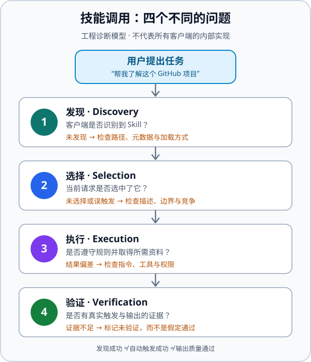

# 为什么技能没有被正确触发

> **本篇问题**：明明已经有 `SKILL.md`，为什么用户请求与技能有关时，Agent 却没有调用它？反过来，为什么不相关的请求也可能误触发？

## 本篇索引

这一篇不延续会议纪要的故事，而是为一个新的真实需求设计技能：**帮助读者快速理解陌生的 GitHub 项目**。

完成后，你应该能够：

1. 区分技能的**文件有效性、客户端发现、选择触发、执行行为**四个关口。
2. 解释显式调用和隐式调用（Implicit Invocation）各自解决什么问题。
3. 为 `description` 写清楚「任务、输入、预期结果、适用边界」。
4. 用正例、反例和边界测试观察触发行为，不把“回答看起来对”当作触发证据。
5. 借由这次实践理解**接口契约（Interface Contract）**和**关注点分离（Separation of Concerns）**。

前置阅读：[为什么需要智能体技能](./01-why-agent-skills.md)。

## 一、一个“明明安装了”的困惑

假设你经常阅读开源项目。你想让 Agent 在拿到 GitHub 仓库链接时，先给出：

- 项目用途与适合解决的问题；
- README 指向的入口和快速开始方式；
- 实际能从仓库证实的技术栈；
- 一个适合初学者的最小实验；
- 无法读取或尚未核实的地方。

为此你建立了一个 `github-repo-guide` Skill。

但测试时出现三个现象：

**现象 A：** 用户输入“帮我认识一下这个开源仓库”，Agent 直接用普通回答，没有明确选用技能。

**现象 B：** 用户输入“帮我修复仓库里的 CI 测试”，Agent 却试图运行你的“项目理解”流程，而不是处理代码修复任务。

**现象 C：** 用户显式选用了技能，结果仍然凭空编造了不存在的安装命令。

这三个现象看起来都像“Skill 不好用”，实际上可能位于完全不同的环节。没有区分它们，就很难知道该改什么。

## 二、把整个调用过程拆开观察



我们可以把一次调用分成四个检查关口：

| 关口                    | 要回答的问题                       | 常见故障                               |
| ----------------------- | ---------------------------------- | -------------------------------------- |
| 1. 发现（Discovery）    | 当前客户端是否识别到这个 Skill？   | 放错目录、未刷新、元数据格式不符合要求 |
| 2. 选择（Selection）    | 这次用户请求是否选中了它？         | 描述过宽、过窄、与其他技能重叠         |
| 3. 执行（Execution）    | 选中后是否遵守技能和本次用户指令？ | 忽略边界、没有访问资料却猜测           |
| 4. 验证（Verification） | 能否证明选择和结果符合预期？       | 只看到“回答合理”，没有调用证据         |

注意这不是所有 Agent 内部实际实现的一张统一流程图，而是**为了定位问题而设计的观察模型**。不同产品可能采用不同的发现与调用机制。

**关键原则**：发现成功 ≠ 自动触发成功；触发成功 ≠ 结果正确；结果看似正确也不能反证已触发。

## 三、显式调用与隐式调用

在支持 Skill 的客户端中，通常存在两类使用方式：

**显式调用（Explicit Invocation）**：用户通过客户端支持的选择器、命令或明确的技能引用来指定技能。用于首次检查“是否被发现”和“指令是否可执行”尤其方便。

**隐式调用（Implicit Invocation）**：用户只描述自己的任务，客户端或 Agent 根据技能元数据与上下文判断是否使用技能。它减少了用户记忆技能名称的成本，但行为具有不确定性。

以 [ChatGPT / Codex Skills 文档](https://learn.chatgpt.com/docs/build-skills)为例，支持的调用方式和安装位置由具体产品决定。不要把某个客户端的触发语法当成所有 Agent 的统一规范。

在 Codex 中，也应检查技能是否被配置为允许隐式调用。**不允许隐式调用的技能不能靠修改 `description` 强行实现自动触发。**

### 为什么 `description` 很重要？

`description` 至少要回答：

- 它为**什么任务**提供帮助？
- 何时使用，输入一般是什么？
- 它会给用户什么类型的结果？
- 哪些相近请求**不属于**它的职责？

开放规范把 `name` 与 `description` 视为必需元数据。`description` 不只是 README 的短介绍，也参与技能的适用性判断；但它不是“看到关键字就必定调用”的硬编码规则。参见[Agent Skills 规范](https://agentskills.io/specification)。

## 四、修复一个模糊的描述

先看这个过宽的描述：

```yaml
---
name: github-repo-guide
description: 处理 GitHub、开源和编程相关的任何问题。
---
```

它容易把“解释项目”“修复 CI”“编写代码”“寻找招聘信息”等不同目标混成一类。

改成：

```yaml
---
name: github-repo-guide
description: 当用户希望理解一个 GitHub 仓库、评估是否值得试用或学习其基本用法时，读取可访问的仓库文档，概括项目用途、入口、技术栈及一个最小试用步骤；不负责修改代码、修复 CI 或替用户发布项目。
---
```

更具体，不等于越长越好。这里包含**适用任务、典型输入、交付范围和排除边界**，能帮助客户端区分相似请求。

### 最小技能正文

以下是教学示例，不代表该 Skill 已在任何客户端安装或验证。

```markdown
---
name: github-repo-guide
description: 当用户希望理解一个 GitHub 仓库、评估是否值得试用或学习其基本用法时，读取可访问的仓库文档，概括项目用途、入口、技术栈及一个最小试用步骤；不负责修改代码、修复 CI 或替用户发布项目。
---

# GitHub 项目快速理解

适用于用户希望认识、评价或初步试用某个 GitHub 项目的情况。

1. 先定位用户指定的仓库，优先读取 README、项目入口和
   与问题直接相关的文件；不要无目的地遍历所有源代码。
2. 分别说明项目想解决的问题、已从仓库核实的功能、
   技术栈及最小试用步骤。
3. 缺少仓库访问权限或文件不可用时，明确说明未核实的
   项目事实，不得推测存在某条安装命令。
4. 如果用户只是请求修复代码、提交 PR 或配置 CI，
   不要将本技能的“项目导览”流程强加给该任务。
5. 默认只读。未经明确授权，不修改仓库文件、不提交、
   不推送，也不运行来源不明的安装脚本。
```

这个示例中“默认只读”是一条**行为规则**，不是平台级的权限隔离。真正能不能写文件仍取决于 Agent 所连接的工具及其权限设置。因此，安全边界需要同时从指令与工具权限两侧验证。

## 五、先预测，再做触发实验

测试之前，先写出预期，避免看到结果再改变通过标准。

| 编号 | 用户请求                                    | 期望触发？ | 原因                                   |
| ---- | ------------------------------------------- | ---------- | -------------------------------------- |
| P1   | “帮我了解这个 GitHub 项目主要有什么作用。”  | 是         | 项目导览                               |
| P2   | “我想试用这个开源仓库，从哪里开始？”        | 是         | 快速入门                               |
| P3   | “分析此仓库的 README，告诉我适用场景。”     | 是         | 资料理解                               |
| P4   | “这个仓库值得我学习吗？先给项目概览。”      | 是         | 项目评估                               |
| N1   | “修复 GitHub Actions 失败的测试并提交 PR。” | 否         | 代码修改与交付                         |
| N2   | “请帮我写一个 GitHub issue 标题。”          | 否         | 消息起草                               |
| N3   | “如何使用 Git rebase？”                     | 否         | Git 通用知识                           |
| N4   | “把这个仓库的 LICENSE 更新为 MIT。”         | 否         | 仓库修改                               |
| B1   | “先解释项目，再修复错误。”                  | 视调度而定 | 复合任务，需要区分先导览与后续代码修改 |
| B2   | “解释这个仓库，里面可能有我的私人文件。”    | 要谨慎     | 需先明确可以读取的范围与隐私边界       |

上表是**设计的期望行为**，不是运行成绩。B1 / B2 的具体处理还依赖客户端是否允许多技能组合，以及用户授予的权限。

### 测试顺序

1. **结构层**：验证 `SKILL.md` 的 YAML、名称和目录名。格式错误先修，不能直接开始测试隐式触发。
2. **发现层**：确认客户端列出了 `github-repo-guide`。没有列出时先调查安装位置、加载方式和配置。
3. **显式调用**：手动选择该技能并发出 P1，观察技能指令是否被读取与执行。
4. **隐式调用**：在不显式点名的情况下测试 P1–P4、N1–N4，并记录是否有真实触发证据。
5. **行为层**：即使 P1 触发了，也必须检查它有没有真正读取仓库、是否标明无法核实的信息。
6. **回归层**：修改 `description` 后重新测试同一批请求，查看是否改进了一个问题却引入其他误触发。

尽量保持相同的模型、客户端版本、已安装技能集合与上下文条件。若条件变化，应在记录中注明。隐式调用具有随机性，重要案例需要重复运行，不能凭一次命中就作普遍结论。

### 记录模板

| 测试编号 | 运行环境与模型 | 预期     | 实际是否选中 | 输出是否正确 | 证据位置 |
| -------- | -------------- | -------- | ------------ | ------------ | -------- |
| P1       | 待填写         | 应触发   | 未测试       | 未测试       | —        |
| P2       | 待填写         | 应触发   | 未测试       | 未测试       | —        |
| N1       | 待填写         | 不应触发 | 未测试       | 未测试       | —        |
| N2       | 待填写         | 不应触发 | 未测试       | 未测试       | —        |

若平台无法提供足以判断技能选择的日志，应把结果记作**未验证**，不要仅凭回答风格猜测。可以采用客户端支持的观测方式或隔离对照实验，但要如实说明它们各自的证据强度。

## 六、怎么评价触发好坏？

仅讨论那些“应触发 / 不应触发”标签明确、实际选择可观察的请求：

- **真正例（TP）**：应触发，而且确实触发。
- **漏报（FN）**：应触发，但没有触发。
- **误报（FP）**：不应触发，却触发。
- **真反例（TN）**：不应触发，而且没有触发。

可以计算：

```text
触发精确率 Precision = TP / (TP + FP)
触发召回率 Recall    = TP / (TP + FN)
```

分母为零时，对应指标不能计算。仅有 4 个正例和 4 个反例时，指标只反映这一小组测试，不代表所有真实用户输入。

**更重要的是把三份记录分开**：触发情况、执行轨迹和输出质量。一个技能可能触发指标很好，却持续输出错误的项目事实。

## 七、如何定位失败原因？

假设 P1 没有触发，按以下顺序排查：

1. **客户端看得到 Skill 吗？** 如果看不到，先检查目录、`SKILL.md` 解析和加载状态。
2. **隐式调用是否被允许？** 如果明确禁用，不应继续优化 `description` 来“修复”它。
3. **描述是否覆盖用户任务？** 如果描述只有“GitHub 工具”，任务与结果都不清楚，可改为明确的仓库导览用途。
4. **有没有竞争技能？** 若多个技能描述非常相似，可能出现选择不稳定；应明确职责边界。
5. **任务是否是复合意图？** “认识项目并修复 Bug”不应被简单理解为单一导览任务。
6. **观察证据够不够？** 如果没有选择日志，就只能报告输出行为，不可确定真正触发与否。

如果 P1 已触发但编造了项目事实，就应该调整**执行约束与资料核验**，而不是继续修改触发描述。这是准确定位问题的价值。

## 八、工程思想：把接口契约与执行实现分开

技能的 `description` 有点像软件组件对外公布的**用途契约**：告诉使用者“我解决什么问题，什么时候应该选我”。`SKILL.md` 正文则更像组件内部的**处理规则**。

但与编程语言里的强类型函数调用不同，Agent 对自然语言的选择是概率性判断，不能把用途描述当成绝对的运行时保证。

这引出两条可迁移的设计原则：

**关注点分离（Separation of Concerns）**

- 安装与发现问题，检查客户端和文件布局。
- 触发选择问题，检查任务语义、元数据和其他技能。
- 执行错误问题，检查规则、资料和工具行为。
- 质量问题，检查测试数据、输出和失败记录。

**契约与实现分离（Contract vs Implementation）**

不能因为回答结果很好，就认为技能发现与选择机制正确；也不能因为技能被选中，就认为结果已经通过验收。

## 九、本篇总结与下一步

我们学到的不是“如何写一段更长的 description”，而是**如何把无法触发的问题拆成可观察、可测试的关口**。

本篇的产物应当包括：一份职责明确的 `SKILL.md`、一组正反例输入，以及至少一份真实客户端的测试记录。只有最后一项真的执行过，才可以声明触发经过验证。

接下来产生一个新问题：即使 Agent 正确选择了技能，**用户说“只要一种输出”，它为什么仍可能输出许多无关内容？**

下一篇计划讨论：**怎样设计清晰的技能职责与行为边界**（案例换成面向人的需求梳理 Skill）。

### 知识关联

- [专题索引](./index.md)
- [为什么需要智能体技能](./01-why-agent-skills.md)
- [人工智能与智能体工程](../../index.md)
- [软件工程](../../../08-Software-Engineering/index.md)

### 参考资料

- [Agent Skills 开放规范](https://agentskills.io/specification)（目录与元数据）
- [ChatGPT / Codex Skills 文档](https://learn.chatgpt.com/docs/build-skills)（调用与环境）
- [Agent Skills 的系统化评估](https://developers.openai.com/blog/eval-skills/)（触发正反例与评估）
