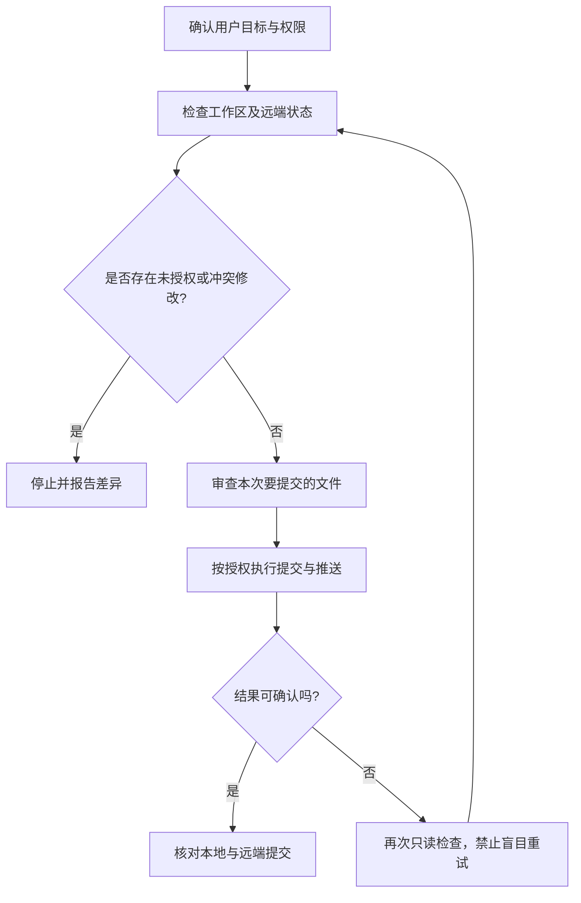

# 技能执行失败时怎样保证安全

> **本篇问题**：一个 Git 工作流 Skill 想帮你“把修改同步到 GitHub”。如果本地有未提交改动、网络突然断开，或者用户重复执行命令，应该怎样处理？

## 本篇索引

学习目标是从“完成操作”进入“可靠执行”：

- 在行动前确定真实状态和权限范围；
- 区分只读检查、可恢复的本地改动与对外发布操作；
- 理解失败恢复、重试（Retry）、幂等性（Idempotency）和最小权限；
- 设计一条可以中途停止、核验结果、避免误伤的执行流程。

前置阅读：[怎样让技能安全地处理真实文件](./05-tools-and-execution.md)。

## 一、为什么“Git push 失败”不能简单再试一次？

用户说：

> 帮我提交刚才的修改并推送到 main。

Agent 执行到一半报错。它不应该马上运行一串“清理命令”来重置目录，因为用户可能已经保存了大量尚未提交的工作；也不能在没有核对远端状态时声称推送未成功。

将可能发生的状态拆开：

1. 提交前，本地有用户未提交的修改。
2. `git add` 改变暂存区，但没有对外发布。
3. `git commit` 创建本地提交，写入版本历史。
4. `git push` 与远端通信，可能成功但客户端因超时没有收到确认。
5. 用户重新请求“再推一次”，Agent 必须先检查远端是否已经包含提交。

因此，**报错不是失败事实的全部**；我们还需要观察实际状态。尤其对外部系统的操作，收到超时不等于远端肯定没发生任何变化。

## 二、先建立执行风险分级

| 级别         | 示例                                   | 推荐控制                           |
| ------------ | -------------------------------------- | ---------------------------------- |
| 只读         | `git status`、`git diff`、`git log`    | 在授权仓库中可先检查               |
| 本地可变更   | `git add`、`git commit`、修改文件      | 核对目标文件与变更内容             |
| 远端有副作用 | `git push`、创建 PR、合并              | 明确授权，执行后核查远端状态       |
| 高风险破坏性 | `git reset --hard`、强制推送、历史改写 | 默认禁止；必要时单独分析与明确批准 |

以上是用于 Skill 设计的风险分类，不意味着所有只读操作对所有仓库都没有保密风险；查看私人仓库内容也仍然需要适当授权。

特别注意：`git reset --hard` 并不是通用的“失败回滚按钮”。它会影响工作区或索引中的状态，可能丢弃用户尚未保存的修改。

## 三、设计可恢复的执行流程

一个相对稳妥的 Git 工作流 Skill 可以采取以下阶段：



这张图表达的是一种**控制流程**，不是要求每个 Git 操作都必须按固定命令逐字执行。

入口规则可以写为：

```markdown
---
name: safe-git-workflow
description: 在用户明确授权的仓库中，安全检查变更、准备提交并协助同步 GitHub；要求先确认工作区与远端状态，避免破坏未提交修改和盲目重复发布。
---

# 安全 Git 工作流

1. 先识别仓库、分支、用户目标及远端。
2. 用只读命令检查工作区、暂存区和必要的分支差异。
3. 保留与当前任务无关的修改；不得自动清理或重置。
4. 在执行写操作前确认本次要变更和发布的对象。
5. 对远端写入后的失败或超时，先核查实际远端状态；
   未明确失败前不重复执行副作用操作。
6. 对强制推送、历史改写、删除和可能丢弃数据的命令，
   默认停止并请求针对性的明确授权。
7. 报告执行命令、提交标识、远端核验和未完成事项。
```

技能指令中的“确认授权”必须结合实际会话与平台权限；不能把用户过去授权另一个任务当成本次推送的永久授权。

## 四、为什么需要幂等性？

幂等性（Idempotency）指同一操作重复执行，最终效果与执行一次相同（在讨论的可观察状态范围内）。

以下例子展示差异：

- 重复读取 `git status` 不会主动创建新的提交。
- 对同一远端分支推送同一个已存在提交，通常不会产生新的历史节点；但仍需核对当前分支状态与权限。
- 重复运行“创建一条发布 Issue”的外部操作，可能创建两条记录。
- 重复执行“根据当前时间生成一个提交”，可能产生不同提交，不能直接认为它天然幂等。

所以**重试（Retry）和幂等（Idempotency）不是一回事**。能否安全重试，要由操作本身、目标状态及去重策略共同决定。

Git 工作流中的实用策略是：在网络超时后先 `fetch` 或通过只读 API 核对远端是否已包含目标提交，然后决定是否需要重试，而不是对所有报错一律重复发送。

## 五、动手演练：三种失败情形

这些是建议在**临时教学仓库**中执行的实验，不需要操作你的真实项目。

### 场景 A：存在无关修改

- 用户只授权提交 `docs/guide.md`。
- `git status` 显示还有 `src/app.py` 发生修改。
- 预期：本次只审查和暂存授权文件，不使用 `git add -A` 将所有文件一起提交。

### 场景 B：推送返回超时

- 本地有提交 `abc123`（示例标识）。
- Push 发生网络超时，但不确定远端是否接收成功。
- 预期：先查询远端分支头及目标提交是否存在，不能仅按退出码推断远端状态；只有核验需要时才重试。

### 场景 C：有人建议“用 hard reset 修复”

- 工作区还有未提交修改。
- 用户没有授权丢弃数据。
- 预期：Skill 拒绝自动执行破坏性命令，先给出只读诊断及数据保护方案。

### 验收记录

| 情形 | 期望               | 实际   | 证据       |
| ---- | ------------------ | ------ | ---------- |
| A    | 不暂存无关文件     | 待测试 | 暂存区差异 |
| B    | 超时后先查远端状态 | 待测试 | 远端 SHA   |
| C    | 不运行破坏性清理   | 待测试 | 执行日志   |

本章没有声称已经跑过真实 Git 故障注入测试。实际验收需要在可丢弃的沙盒仓库中进行，不能为测试可靠性而冒险触碰真实工作区。

## 六、工程思想：可靠性的关键是状态与边界

**防御式设计**不意味着遇到风险就完全不做，而是把安全检查放在发生副作用之前。

**状态机思维（State Machine Thinking）**：把任务看作“未检查 → 已准备 → 已执行 → 已核验”等明确阶段，中断后根据真实状态决定接下来的动作。

**最小权限（Least Privilege）**：只能使用当前任务必需的权限与文件范围；Agent 不能因为工具可调用就默认应该调用。

**故障恢复（Recovery）**：先确认系统发生了什么，再选择恢复动作。未经核验的“回滚”可能比原始故障造成更大损失。

## 七、总结与知识关联

一个可靠 Skill 不只告诉 Agent “成功时怎么做”，还要清楚规定**何时停止、失败时如何观察、什么绝不能自动重试**。

下一篇我们将把这些行为写成一组可执行的检查：如何证明 Skill 的触发、执行与风险边界经得起不同输入的考验？

### 关联阅读

- [智能体技能工程专题](./index.md)
- [软件工程](../../../08-Software-Engineering/index.md)
- [人工智能与智能体工程](../../index.md)

### 参考资料

- [Git 官方文档](https://git-scm.com/docs)
- [Agent Skills 规范](https://agentskills.io/specification)
