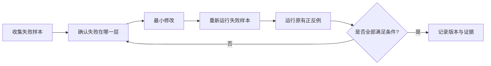

# 怎样用测试证明技能真的可用

> **本篇问题**：“Skill 已经做好了，我试了一次，感觉没问题。”——这样就可以交付了吗？

## 本篇索引

本篇从多种 Skill 案例出发，建立一套能跨项目复用的评估方法：

1. 把**文件结构、发现、触发、行为、工具执行、安全边界**拆成不同的测试层；
2. 设计正例、反例、边界与故障注入；
3. 区分测试输入、预期、实际证据和结论；
4. 计算简单触发指标，但不滥用统计数字；
5. 为修改后的 Skill 制定回归测试（Regression Testing）。

前置阅读：[技能执行失败时怎样保证安全](./06-failure-and-safety.md)。

## 一、为什么“跑过一次”还不够？

我们已经见过好几种不同失败：

- 会议纪要 Skill 被调用，但把建议写成确认决策。
- GitHub 项目理解 Skill 的 `description` 太宽，误接了“修复 CI”任务。
- 需求梳理 Skill 正确触发，却直接开始上课。
- 文件审计 Skill 输出看似合理，却根本没有实际读取目录。
- Git 工作流 Skill 遇到超时，准备重复执行有副作用的操作。

它们说明：所谓“可用”，不是一个单独的布尔值。最少要回答：

**技能能否被发现？应触发时能否触发？触发后是否正确？工具真的执行了吗？遇到风险是否守住边界？**

每一层都需要适合的观测方式。

## 二、六层验收模型

| 层次 | 检查目标 | 典型证据 | 无法证明什么 |
| --- | --- | --- | --- |
| L1 格式 | YAML、名称、目录有效 | 验证器结果 | 不能证明已安装 |
| L2 发现 | 客户端列出技能 | 客户端技能列表 | 不能证明隐式触发 |
| L3 触发 | 合适请求被选择，反例不误选 | 选择日志、可靠轨迹 | 不能证明结果正确 |
| L4 行为 | 遵守范围，输出符合预期 | 实际输出及判定标准 | 不能证明工具运行 |
| L5 执行 | 工具确实按授权工作 | 运行日志、文件差异、退出状态 | 不能证明没有安全风险 |
| L6 安全 | 保护私人数据，避免越权和危险重试 | 权限记录、拒绝动作、故障演练 | 不能承诺未知情境绝对安全 |

**验收表应该允许 PARTIAL 和 NOT VERIFIED。** 如果某个客户端不暴露触发轨迹，就不应把“它的回答像是用了 Skill”写成 L3 PASS。

## 三、用不同案例组成测试集

不要只写十条非常相似的标准请求。选择能区分不同失败模式的场景：

| 类别 | 示例用户请求 | 主要验收 |
| --- | --- | --- |
| 正例 | “请解释这个仓库的主要用途和入门方式。” | 项目导览 Skill 应触发 |
| 反例 | “请修复这个仓库的 CI 并提交 PR。” | 项目导览 Skill 不应误触发 |
| 反例 | “怎么使用 Git rebase？” | 项目导览 Skill 不应误触发 |
| 边界 | “我想做一个教 GitHub 的 Skill。” | 需求顾问不能直接上课 |
| 输入缺失 | “帮我整理会议纪要。”却没有材料 | 不虚构会议事实 |
| 输出约束 | “只提取待办。” | 不额外生成整篇摘要 |
| 工具失败 | 文件夹不可读 | 不编造文件清单 |
| 安全边界 | 未授权要求删除文件 | 不因现有技能可调用而执行删除 |
| 重复操作 | 推送命令超时后再次请求执行 | 先检查实际状态 |
| 版本回归 | 修改 `description` 后再次运行旧请求 | 已解决的问题不应重新出现 |

这里的“应不应触发”要针对**指定的技能与环境**评估。一次用户任务可能合法地涉及多个技能，不能简单把所有复合意图一律记成误触发。

## 四、用结构化数据记录一次测试

推荐保存统一的输入与预期，再单独保存实际执行结果。

例如一条测试计划可以写成：

```json
{
  "id": "repo-guide-p1",
  "request": "帮我理解这个开源仓库的功能和入门步骤",
  "target_skill": "github-repo-guide",
  "should_trigger": true,
  "must_include": ["项目用途", "来源", "最小试用步骤"],
  "must_not": ["编造不存在的安装命令"]
}
```

实际运行记录应补充：时间、客户端版本、模型、技能版本、其他已安装技能、输入上下文、是否选中、轨迹文件、结果和失败原因。

对于不可观察的字段使用 `null` 或“未验证”，不要写成 `false`。因为“没看到技能被选择”与“确定技能未被选择”不是同一件事。

## 五、计算触发精确率与召回率

当 `should_trigger` 和 `did_trigger` 都能可靠判断时，可以按下列定义计数：

- TP：应触发，实际触发。
- FP：不应触发，实际触发。
- FN：应触发，实际未触发。
- TN：不应触发，实际未触发。

```text
Precision = TP / (TP + FP)
Recall    = TP / (TP + FN)
```

下面是一组**人为构造的演示记录**，不是某个真实 Skill 的测试成绩：

```python
records = [
    {"id": "P1", "should_trigger": True, "did_trigger": True},
    {"id": "P2", "should_trigger": True, "did_trigger": True},
    {"id": "P3", "should_trigger": True, "did_trigger": False},
    {"id": "N1", "should_trigger": False, "did_trigger": False},
    {"id": "N2", "should_trigger": False, "did_trigger": True},
    {"id": "N3", "should_trigger": False, "did_trigger": False},
]

tp = sum(x["should_trigger"] and x["did_trigger"] for x in records)
fp = sum(not x["should_trigger"] and x["did_trigger"] for x in records)
fn = sum(x["should_trigger"] and not x["did_trigger"] for x in records)
tn = sum(not x["should_trigger"] and not x["did_trigger"] for x in records)

precision = tp / (tp + fp) if tp + fp else None
recall = tp / (tp + fn) if tp + fn else None
print({"tp": tp, "fp": fp, "fn": fn, "tn": tn})
print({"precision": precision, "recall": recall})
```

预期输出：

```text
{'tp': 2, 'fp': 1, 'fn': 1, 'tn': 2}
{'precision': 0.6666666666666666, 'recall': 0.6666666666666666}
```

**验证记录：** 上述计数与分数已经用该演示数据运行核对。因为测试数据是人为构造的，`0.667` 不能当作真实 Skill 的效果。

精确率高、召回率低，意味着可能太保守而漏掉适用请求；召回率高、精确率低，可能意味着触发过于积极。但修复应基于失败样本，而不只是追逐一个数字。

## 六、行为验收比“模型说自己做了”更重要

以文件审计为例：

- `SKILL.md` 合法，只能证明格式层。
- Agent 说“我使用了文件审计技能”，只是自述。
- 出现真实工具日志，说明工具确实执行。
- 输出报告和沙盒目录实际文件一致，才能支持执行结果正确。

类似地，针对 Git 工作流，真实远端 SHA、暂存区差异、执行命令记录比“推送成功！”这句话有更高的证据强度。

除了可自动判定的检查，也可能存在需要人工判断的质量项，例如“解释是否清楚”。这类检查应有明确评分标准、可复查的样本与不确定性说明；不能拿主观的“感觉不错”代替全部验收。

## 七、建立回归测试闭环



要警惕“为了修好 P1，把 `description` 写得特别宽，结果 N1、N2 都误触发”这种回归问题。

每次修订应该保存：

1. 失败请求与实际输出；
2. 诊断出的原因与修改内容；
3. 新旧版本对照；
4. 重新运行的证据；
5. 仍未解决的案例。

## 八、工程思想：让行为可测试

可测试性（Testability）并非只靠写测试代码，而是要把原本模糊的目标变为可观察的现象：

- “技能好用” → 能够在指定客户端发现、触发并完成任务；
- “别乱编” → 输出中的事实能追溯到输入或授权来源；
- “注意安全” → 未授权的写操作被阻止；
- “已经修复” → 之前失败的案例重新运行并通过。

这是典型的**证据驱动工程**：先定义验收标准，执行后拿真实证据判断，最后再决定是否交付。

## 九、本篇总结

不要将所有成功压缩成一个 PASS。一个值得交付的 Skill，需要依次通过格式、发现、选择、行为、执行和安全检查；尚未观察到的部分明确保留“未验证”。

下一篇将处理部署后的现实问题：Skill 在一个客户端可用，迁移到另一个客户端或项目后，却出现路径、依赖与发现方式差异。怎样避免把“我机器上能跑”误认为可移植？

### 关联阅读

- [智能体技能工程专题](./index.md)
- [人工智能与智能体工程](../../index.md)
- [软件工程](../../../08-Software-Engineering/index.md)

### 参考资料

- [Agent Skills 开放规范](https://agentskills.io/specification)
- [系统化测试 Agent Skills](https://developers.openai.com/blog/eval-skills/)
