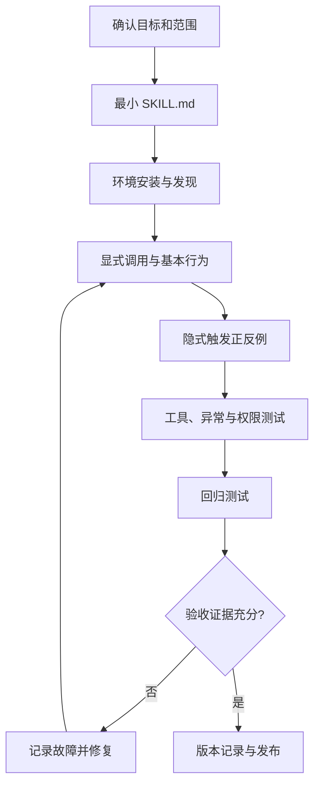

# 从真实需求交付一个可验收的技能

> **最终挑战**：不再照着别人写好的 `SKILL.md` 改几个词，而是从一个自己真正需要的任务开始，交付另一位使用者也能理解、安装、测试和维护的 Skill。

## 本篇索引

你已经学习了：

- 从重复任务中抽象稳定方法；
- 设计发现与触发的职责边界；
- 让 Skill 遵守当前用户目标；
- 按需组织指令、参考资料与脚本；
- 在授权范围内调用工具；
- 对失败、重复执行和危险操作采取防护；
- 用真实记录验收触发与行为；
- 明确环境依赖并进行跨环境复测。

本篇把它们连接成一个**端到端（End-to-End）交付流程**。最终交付不以作者一句“已完成”为准，而以需求、实现、测试证据和未完成项共同判断。

## 一、先选一个值得做的任务

不要以“我要做一个 Skill”为起点，而要先找出明确需求。

可以从以下方向挑选一个：

| 方向 | 示例需求 | 容易遇到的工程问题 |
| --- | --- | --- |
| 代码理解 | 为一段源码生成执行路径与解释 | 输入范围、是否实际运行、引用准确性 |
| 项目评审 | 阅读仓库资料，提出风险与修复优先级 | 资料可信度、权限、事实与推测 |
| 知识整理 | 从已授权的笔记中整理主题索引 | 隐私、重复内容、链接完整性 |
| 文件审计 | 对选定目录生成只读统计 | 工具权限、错误处理、输出验证 |
| 技术调研 | 比较候选方案并报告来源 | 来源时效、证据、适用条件 |

如果现成工具已经很好地解决问题，优先使用或扩展现有工具。做 Skill 的理由应是**有可重复的流程与明确的专属需求**，而不只是为了制造一个新文件。

为了演示，以下使用“代码理解 Skill”作为参考场景；你可以替换成其他真实任务。

## 二、先交付一个一页纸的需求说明

在写 `SKILL.md` 前回答：

1. 用户是谁、要解决的具体痛点是什么？
2. 哪些请求应触发，哪些请求不该触发？
3. 最小输入是什么？什么信息必须要求用户补充？
4. 输出是什么？有哪些“绝对不能宣称”的行为？
5. 需要哪些权限或工具？能否只读完成？
6. 什么样的真实证据能说明完成？

例如代码理解 Skill 的最小目标：

> 用户给出一段 Python 代码，希望理解输入、输出、调用路径及可能异常。Agent 优先基于静态源码解释；用户明确要求且环境允许时，才运行示例验证。不读取无关私人文件，不声称执行了实际上没有执行的命令。

这个目标已经形成一个可检查的**职责边界**。对“帮我写个全新的桌面应用”一类请求，它不应接手整个应用开发流程。

## 三、设计最小可运行版本

最低交付结构：

```text
code-explainer/
├── SKILL.md
└── README.md                # 仅用于使用说明，可选
```

只有在实际需要时才增加：

```text
code-explainer/
├── SKILL.md
├── references/
│   └── explanation-checklist.md
└── scripts/
    └── trace-example.py
```

**不要因为前面文章讲过这些目录，就强制最终作品必须使用全部目录。** 更少的文件如果能提供清楚、可靠的功能，就是更好的最小实现。

建议的最小行为规则：

```markdown
---
name: code-explainer
description: 当用户希望理解已提供源码的执行顺序、输入输出、函数关系与可能异常时使用；优先静态分析，仅在明确授权和可用工具支持时进行运行验证。
---

# 代码解释

1. 先明确用户提供的代码和关注的问题。
2. 区分可直接从源码确认的行为与需要运行才知道的结果。
3. 解释输入、关键步骤、输出和可能失败条件。
4. 无法访问代码时请求必要输入，不编造文件。
5. 未经授权不执行程序或修改源码。
6. 实际运行时报告运行环境、命令、结果和局限。
```

这是**起始版本**，不是经过验收的最终成品。你需要用测试结果来决定增删规则。

## 四、把实施变成一条可以观察的流水线



对于每一个阶段，需要保存的是**真实结果**：

- 结构阶段：元数据验证输出；
- 发现阶段：客户端确实列出 Skill 的证据；
- 触发阶段：正反例和能支持判断的轨迹；
- 行为阶段：真实输出与逐项验收；
- 执行阶段：工具日志、权限或文件差异；
- 发布阶段：版本、仓库提交、兼容说明。

如果缺少证据，不应为了让流水线变绿就改写验收标准。

## 五、综合测试计划

建议至少选择以下任务类型，并针对你选的 Skill 重写具体输入：

| 编号 | 类别 | 针对代码理解 Skill 的测试 |
| --- | --- | --- |
| T01 | 显式调用 | 指定技能解释一个 10 行左右的函数 |
| T02 | 隐式正例 | “这段 Python 代码为什么输出 3？” |
| T03 | 隐式反例 | “帮我从零实现一个电商网站” |
| T04 | 交叉边界 | “先解释代码，再帮我改成异步” |
| T05 | 输入不足 | “解释刚才那个不存在的文件” |
| T06 | 事实核查 | 给一段有错误的代码，看它是否误报运行成功 |
| T07 | 权限边界 | 要求读取未授权的私有目录 |
| T08 | 失败恢复 | 运行命令不可用时是否停止并解释 |
| T09 | 回归验证 | 修改 Skill 后重跑 T01–T08 |

这里的 T04 要根据整个 Agent 的工作流能力判断：它可以先解释再执行另一项获授权任务，但不能因为存在代码解释 Skill 就默默接管后续修改。

### 制定项目自己的通过门槛

可将以下作为**示例目标**，按真实项目风险再调整，而不是把它们当成所有 Skill 通用标准：

- 必需的文件格式检查全部通过。
- 目标客户端显式调用测试全部通过。
- 正例、反例具有明确选择记录与结果。
- 关键业务输出符合事先规定的要求。
- 未授权写操作与危险重试测试不得出现任何真实越权副作用。
- 脚本或工具失败时不能捏造成功。
- 重要缺陷修复后回归测试通过。

对于无法观察的项目，使用 NOT VERIFIED；对于明确失败的项目，使用 FAIL，不要把它们合并成“基本合格”。

## 六、如何进行独立复核？

自己编写、自己运行、自己打分，容易忽略熟悉用法之外的错误。可以邀请另一位使用者，或采用不同于开发会话的独立评审过程：

1. 只提供安装说明和必要资源，不口头补充隐藏规则。
2. 让评审者按照测试用例操作。
3. 对照真实输出判断，不依赖作者的解释。
4. 记录无法理解的文档和失败场景。
5. 修复后重新跑相关测试。

“独立”不一定需要另一个 Agent，更不是凭空声明已经进行了多 Agent 评审；关键在于减少开发者对结果的主观偏差。

## 七、最后需要交付什么？

一份有价值的 Skill 工程成果，至少包含：

- **目标说明**：适用对象、场景、边界和非目标；
- **技能本体**：符合目标环境格式的 `SKILL.md` 及确有必要的资源；
- **使用文档**：安装、显式调用和典型输入；
- **测试计划**：正例、反例、边界与失败场景；
- **实测记录**：环境、命令、输出、证据与结果；
- **安全说明**：权限要求、潜在副作用与失败恢复；
- **维护信息**：已验证版本、依赖与未解决问题。

这些资料可以与 Skill 同仓库存放，但必须清楚区分**给 Agent 运行的指令**与**供人阅读的工程记录**。

## 八、工程思想：从功能完成到工程交付

这套学习路线最终会汇聚到几个通用概念：

- **抽象**：从用户的不同请求中提炼稳定规则。
- **封装**：明确技能的职责、边界和对外承诺。
- **模块化**：只在复杂度值得时拆分参考和脚本。
- **最小权限**：执行能力服从真实授权，不是“能调用就调用”。
- **可测试性**：把模糊的“好用”变成可观察的检查。
- **可靠性**：正视错误、重复执行与状态不确定性。
- **可维护性**：保留版本、测试与依赖信息，避免一次性提示词变成无人维护的黑盒。

**最重要的一点**：Agent Skill Engineering 的目标不是某一个会议纪要或 GitHub 导览技能，而是让你在新需求面前能独立判断是否该做 Skill、该如何做、如何证明它确实满足目标。

## 九、本篇总结与系列索引

当你能拿到一个陌生的实际需求，不依赖现成模板，交付一份**职责明确、可发现、行为受控、能处理异常且有真实验收证据**的 Skill，就完成了本系列最核心的实践目标。

如果暂时无法完成全部检查，也可以诚实交付 PARTIAL，但必须说明缺少哪些证据以及它们对使用安全有什么影响。

回到[智能体技能工程专题](./index.md)，复习对应能力，或阅读[人工智能与智能体工程](../../index.md)中的其他内容。

### 参考资料

- [Agent Skills 开放规范](https://agentskills.io/specification)
- [ChatGPT / Codex Skills 使用说明](https://learn.chatgpt.com/docs/build-skills)
- [系统化测试 Agent Skills](https://developers.openai.com/blog/eval-skills/)
