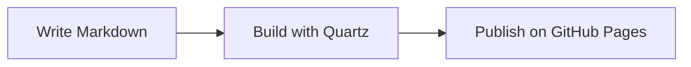
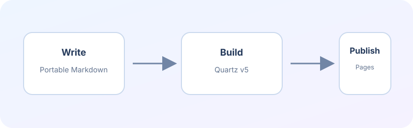
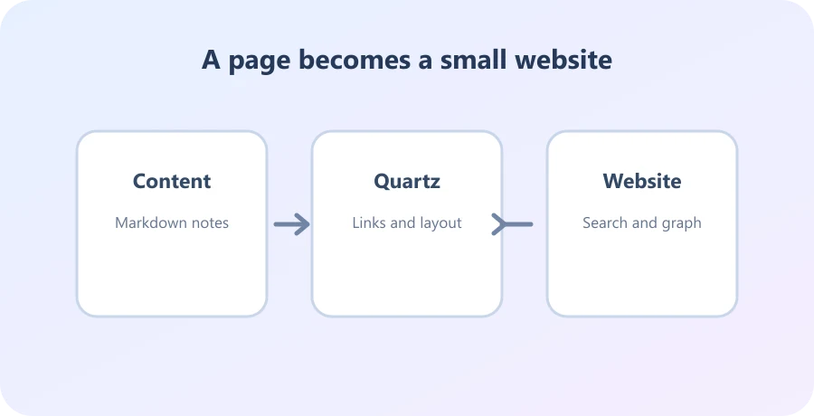

# Authoring Guide

This page demonstrates the Markdown features supported by this site. Edit these files in Obsidian or any text editor; Quartz builds the same Markdown into the website.

## Frontmatter

Put YAML metadata at the top of a page:

```yaml
---
title: Example Topic
description: A short summary shown in search and previews.
tags:
  - example
  - computer-science
aliases:
  - Example
---
```

Use a clear title, a short description, and lowercase kebab-case tag values where practical.

## Headings and lists

Use headings in order and keep one top-level heading per page. Lists work as standard Markdown:

- Give each page one main idea.
- Link to related pages where useful.
- Keep paragraphs focused and concise.

## Internal links and relative links

Obsidian wikilinks are supported: [[Welcome]] and [[Computer-Science|Computer Science]]. A regular relative Markdown link also works: [Welcome](Welcome.md).

Prefer links that make sense in both Obsidian and a rendered website. Keep filenames in English kebab-case.

## Tags

Add page tags in YAML frontmatter, as shown above. Inline tags such as #authoring are supported too.

## Callouts

Obsidian callouts use the `>` blockquote form:

> [!note] Keep examples small
> A focused example makes a page easier to maintain and reuse.

> [!warning] Public repository
> Anything committed here can be published. Never add credentials, private notes, or local vault metadata.

## Mermaid diagrams

Use a Mermaid code fence for simple processes and relationships:



## Local images

Keep shared illustrations in `content/assets/illustrations/`, and link to them with a path relative to the current note:





Give each image meaningful alt text. Keep images separate from explanatory Markdown, avoid duplicates, and do not put temporary generated files in `content/`.

## Asset conventions

Contributor and asset conventions are documented in the repository `docs/` folder.
