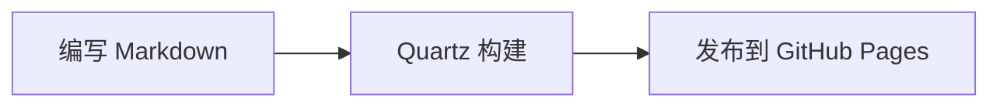

# 内容编写指南

本指南展示网站支持的写作方式。你可以在 Obsidian 或普通文本编辑器中修改 Markdown 文件，再由 Quartz 构建为网站页面。

## 页面元数据

在文档开头添加元数据：

```yaml
---
title: 示例主题
description: 用一句话概括页面内容。
tags:
  - 示例
  - computer-science
aliases:
  - Example Topic
lang: zh-CN
---
```

为页面设置中文标题、简短摘要和相关标签；英文专业术语可以放入 `aliases` 作为检索别名。文件名和路径使用英文 kebab-case。

**默认语言规范：标题中文、链接中文、正文专业术语中英结合、文件路径英文。**专业术语首次出现时写作“中文（English）”，之后按语境使用中文或英文；代码标识符、命令和协议缩写保留原文。英文检索词应出现在正文中；Frontmatter `aliases` 适合 Obsidian 别名链接，但 Quartz 站内全文搜索不保证索引 aliases。

## 标题与列表

使用层次清晰的标题，每个页面聚焦一个主题。标准 Markdown 列表可用于组织要点：

- 先说明概念或问题。
- 再解释关键原理与适用范围。
- 链接到相关页面，避免重复解释。

## 内部链接与相对链接

双向链接（Obsidian wikilinks）可直接链接到本库中的页面，例如 [[Welcome|欢迎页面]] 和 [[../Computer-Science/index|知识领域入口]]。普通相对 Markdown 链接同样可用：[欢迎页面](Welcome.md)。链接可见文字使用中文，目标路径保持稳定。

优先使用描述清楚的链接文字，并确保目标文件确实存在。

## 标签

在 YAML frontmatter 中添加主题标签；正文中的行内标签（例如 `#authoring`）也受支持。保持标签稳定、简洁且便于检索。

## 提示框

Obsidian callout 使用引用块语法：

> [!note] 写作提示
> 一个页面尽量讲清一个主题，并用链接连接相关概念。

> [!warning] 公开内容
> 提交到仓库的内容可能发布到公开网站。请勿加入私密笔记、凭据或本地 vault 配置。

## 流程图示

简单流程或关系图可以使用 Mermaid code fence：



## 本地图片与相对路径

共享插图放在 `content/assets/illustrations/`，通过相对于当前页面的路径引用：


为每张图片提供有意义的 alt text。资源规范见仓库维护文档 `docs/asset-guidelines.md`。
